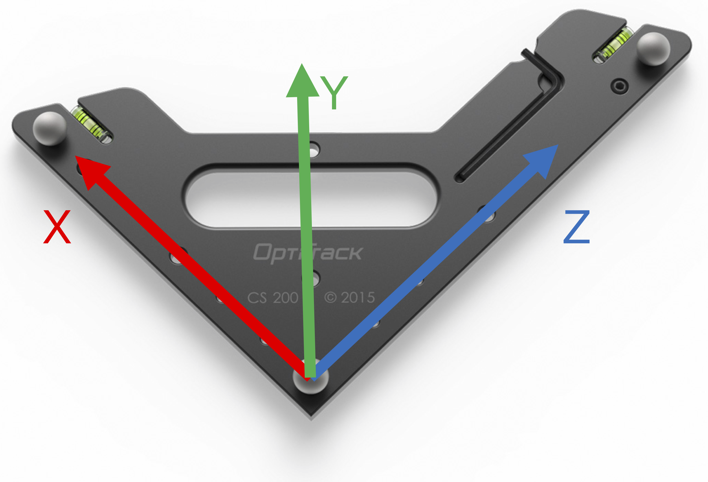

If a camera goes down or is replaced, the system must be recalibrated.

!!! warning "One Malfunctioning Camera Can Cause Intermittent Problems"
    A single malfunctioning camera can cause problems that come and go. They can be as rare as one bad frame in 30 minutes, so they are easy to miss. If the mocap data glitches now and then, check every camera before you blame the robot or the software.

## Motive and Its License Key

The Indoor Lab's motion capture runs on OptiTrack Motive, version 2.0.2.

* **Where it runs:** Motive can run on any Windows 11 computer, but it requires the USB license tool (the key) to run. The key is currently in the Windows 11 PC.
* **Old software:** Motive 2.0.2 is quite old and may not run on newer versions of Windows. There is a spare key in the lab for an even older version of Motive (version: *Unknown*{ .unknown }), and whether it runs on Windows 11 is *Unknown*{ .unknown }.
* **No reason to change:** the current key works, so there is no motivation to change anything until Windows is forced to upgrade (e.g., beyond Windows 11).

!!! danger "Never Remove or Lose the USB License Key"
    Do not remove the key from the Windows 11 PC. If you lose the key, all access to Motive is lost, and a new key is needed. A new key costs $999: see [Motive pricing](https://www.optitrack.com/software/motive/pricing).

[Software License Info](https://docs.google.com/document/d/1jM9DrLQwrWCJjM_5NqterbRs9uddT3d-WA3wOgBniV4/edit?tab=t.0){ .md-button }

## Mocap Tutorial Video

This video covers the mocap tutorial and the `bebop_common` autonomy stack for the Bebops.

<iframe width="560" height="315" src="https://www.youtube.com/embed/2qiJW6F9iWw" title="YouTube video player" frameborder="0" allow="accelerometer; autoplay; clipboard-write; encrypted-media; gyroscope; picture-in-picture; web-share" referrerpolicy="strict-origin-when-cross-origin" allowfullscreen></iframe>

## The Cameras

The Indoor Lab has 20 OptiTrack Prime 17W cameras mounted. There may be spares, but nobody knows where they are right now.

## Calibration File for MAE-A 313

The current calibration file is `main.cal`. It is already on the Motive computer (MAE-MH-BPLKHL2), in `C:\Motive 2.02 NCR Calibration Files`. This download is a backup copy. It was made in October 2025, and Motive rated its accuracy "Exceptional". Its mean error is *Unknown*{ .unknown }.

A calibration belongs to one space and one camera arrangement. A new space needs a new calibration.

[Download the Calibration File](mae-a-313-main.cal){ .md-button download="mae-a-313-main.cal" }

## Motive Installer

The Motive 2.0.2 installer needs no login to download. Running Motive still needs the USB license key.

[Download the Motive 2.0.2 Installer](https://drive.google.com/file/d/1-iwubh2fYvJMuSaYW6uyuK_54jqeBLSN/view?usp=drive_link){ .md-button }

## Steps

1. **Remove all robots with markers from the camera field of view**  
	- Place the robots in a locker or cover them to avoid interference.

{ align="center" width="50%" }

{ align="center" width="50%" }

2. **Set the OptiTrack reference**
	- Obtain the **wand** and the **OptiTrack calibration square**.
	- Place the OptiTrack at the lab coordinate origin.
	- Align the square so its axes match the lab coordinate axes.

{ align="center" width="50%" }
   
3. **Start wanding**
	- Launch **Motive**.
	- Click **Start Wanding**.
	- Move the wand throughout the lab so that all cameras collect samples. You will see the ring around each camera turn green as it gathers sufficiently many samples

4. **Calculate calibration**
	- Continue wanding until each camera collects **several thousand samples**.
	- Click **Calculate**.

5. **Apply calibration**
	- Click **Apply Result**.
	- Save the **calibration file**.

6. **Set ground plane**
	- Click **Set Ground Plane** to finalize the coordinate frame.