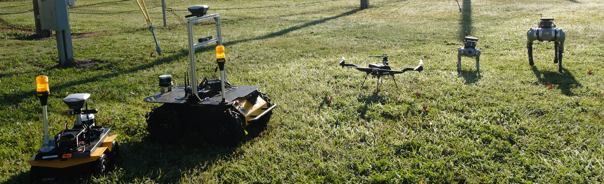

  
   
  

The wiki for the UF Autonomy Park and the SCC Lab: our robots, hardware, networks, and software.

[Start Here](start-here/start-here.md){ .md-button .md-button--primary }
[Autonomy Park SITL](software/autonomy-park-sitl.md){ .md-button }
[Autonomy Park GitHub](https://github.com/UFL-Autonomy-Park/){ .md-button }
[SCC Lab Website](https://scc-lab.github.io/){ .md-button }

!!! warning "Notices"
    **Multi-agent quadcopter experiments are not possible right now** (2026-11-03). See [Lab Rules](start-here/lab-rules.md).

    **Autonomy Park SITL is now the unified pipeline for experiments** (2026-11-10). Multi-agent quads and ground robots coming in 2027. See [Autonomy Park SITL](software/autonomy-park-sitl.md).

- **[Robots](robots/quadcopters/homebrew/overview.md)**

    [Homebrew](robots/quadcopters/homebrew/overview.md), [Freefly](robots/quadcopters/freefly/overview.md), [Parrot Bebop 2](robots/quadcopters/parrot-bebop-2/overview.md), [Clearpath](robots/ground-robots/clearpath/overview.md), and [Unitree](robots/ground-robots/unitree/overview.md).

- **[Hardware](hardware/computing-hardware.md)**

    Computers, Jetsons, controllers, RTK, and more.

- **[Networking](networking/networking-equipment.md)**

    Network gear, time sync, VPN, and the file backup server.

- **[Software](software/software-we-use.md)**

    What we install, and how.

- **[Edit the Wiki](start-here/edit-the-wiki.md)**

    If you change a robot, document it here.

