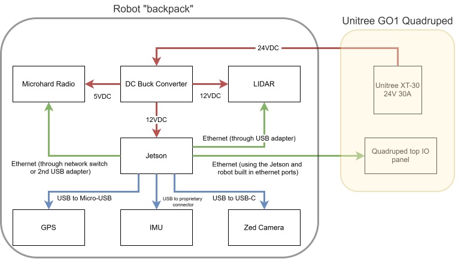

{ width="40%" }

Go1 is the smaller of the two quadrupeds available. It can be carried by a single person and has a runtime of about 10 minutes with all sensors enabled and high Jetson utilization.

Quadrupeds require energy to remain standing. As explained in the startup video below; once standing, pressing the handheld controller button combo `L2 + a` causes the robot to stop moving forward or adjusting its gait. Then, pressing `L2 + a` again will cause the robot to sit down. WARNING, the motors are still energized! Then, press `L2 + b` to cut power to the motors. Now the robot is safe to work on if you need to adjust something without powering the robot off, or are waiting to start your experiment. This is also the procedure you should use to turn the robot off. Disconnecting the battery while standing will cause the quadruped to immediately crash to the ground.

To return the robot to a standing position, press `L2 + a` then `L2 + a` and press the `start` button to allow the robot to be driven remotely or by the handheld controller.

Do NOT press any buttons on the handheld controller before the quadruped stands up for the first time after being turned on. The internal computers have not finished booting and your inputs will be misinterpreted and the robot will flail wildly.

Attempting to use any of the manufacturer supplied "trick" routines that are shown on the handheld controller will cause 5 figures worth of damage if the backpack is installed. Do not leave the handheld controller unattended with the robot on. This robot will crush your fingers if you try to move it while it is standing or has motors energized. It is fast enough to fall over on its face if you are using the handheld controller and let off the translation stick.

## Our Go1s

We have three Go1s.

| ID | Ready to Use | Location | Last Updated |
|---|---|---|---|
| 164 | Updated to latest `ground_docker`, discovery server integration broken | Autonomy Park | 2026-11-18 |
| 165 | Undergoing software upgrade process | Autonomy Park | 2026-11-18 |
| 166 (Scooby) | In use by Dr. Mao (has old backpack revision) | Indoor Lab | 2026-11-18 |

{ width="40%" }

## Quadruped Startup

<iframe width="560" height="315" src="https://www.youtube.com/embed/Iqmoot6-QBY?si=c1hXt8UjScOSQu9Z" title="YouTube video player" frameborder="0" allow="accelerometer; autoplay; clipboard-write; encrypted-media; gyroscope; picture-in-picture; web-share" referrerpolicy="strict-origin-when-cross-origin" allowfullscreen></iframe>


## Dog ROS2 Startup Instructions
--8<-- "rtk-first.md"
[RTK Setup](../../../hardware/rtk-setup.md){ .md-button }

1. Before turning the quadruped on, disconnect the backpack XT-30 connector from the quadruped (it pulls too much power and the go1 computer will not command the dog to initially stand up under the backpack load). Additionally, disconnect the LIDAR USB-Ethernet adapter from the Jetson. 
2. Turn the quadruped on and wait 2-3 minutes until it stands up. Now plug the backpack back in and wait for the Jetson to boot up for 2-3 minutes before reconnecting the LIDAR USB-Ethernet adapter (it forces the jetson to go into netboot and fail to load the OS from internal EMMC).
3. Now, the robot should be broadasting topics and available to run your experiment or connect over SSH and configure.

## Static Transforms

Static transforms allow the ROS2 TF library to convert all sensor measurements into a single robot frame. We have chosen to use a forward-left-up convention for the XYZ axes on the quadrupeds. Lidar and GPS data only requires distance transformations which are given below and are available in `minimal_startup_ground/launch/transforms.launch.py`. The IMU requires a rotation because of how it is mounted. The Zed camera also requires a rotation as it is angled slightly down, the exact angle and all transform distances can be found in the solidworks model in the `common-cad` github repository.

```python
("unitree", "go1"): {
    "gps": {
        "xyz": (
            -0.10500325,
            -0.05434096,
            0.31012496, 
        ),
        "rpy": (0.0, 0.0, 0.0),
    },
    "imu": {
        "xyz": (
            -0.09006632,
            0.04502905,
            0.30829096,
        ),
        "rpy": (
            0.0,
            3.141592653589793,
            0.0,
        ),
    },
    "lidar": {
        "xyz": (
            0.212636626493108,
            0.00104806745515145,
            0.116780107191393,
        ),
        "rpy": (0.0, 0.0, 0.0),
    },
    "zed": {
        "xyz": (
            0.204953137519962,
            0.0010480674551517,
            0.173346896330377,
        ),
        "rpy": (
            0.0,
            0.2617993877991494,
            0.0,
        ),
    },
},
```

## Manual

[Go1 Manual](go1-manual.pdf){ .md-button }


## Backpack
To allow the quadruped to be controlled independently of the current Autonomy Park ROS version, a Nvidia Jetson Orin computer is attached to the top of the quadruped. The Jetson interfaces with the quadruped, aggregates sensor data, and can run experiment code. 

### Hardware
This section WIP. Check `common-cad` on github.

### Wiring Diagram

{ width="100%" }
