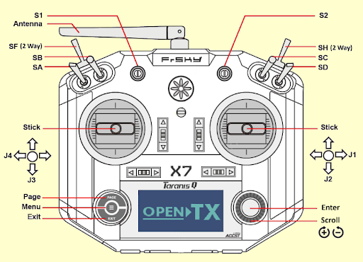

New to flying? Practice in a simulator first.

[Quadcopter Flight Practice](../../../software/quadcopter-flight-practice.md){ .md-button }

--8<-- "rtk-first.md"

[RTK Setup](../../../hardware/rtk-setup.md){ .md-button }

--8<-- "good-fix-quadcopter.md"

--8<-- "flight-modes-danger.md"

--8<-- "lidar-flow-clearance.md"

--8<-- "battery-watch-danger.md"

--8<-- "qx7-personal-note.md"

## Safety and Legal Requirements
**Flying these drones is inherently dangerous.** Failure to follow these protocols results in personal liability for equipment damage and FAA violations.

### Range and Legal Boundaries
* **The Net is the Limit:** Only fly inside the Autonomy Park’s net. Legally, the net is considered an "indoor" environment.
* **FAA Warning:** Flying outside the net requires an FAA license, a registered drone, and prior airspace clearance via an approved vendor. Violations can carry fines between $10,000 and $100,000.
* **Line of Sight:** The pilot must maintain a continuous line of sight with the drone at all times.

### Personal & Bystander Safety
* **Attire:** Tie back loose hair and clothing. 
* **No Gloves:** Pilots must never wear gloves; full tactile feedback from the gimbals is required for precise control.
* **The "Live" Rule:** Never work on a drone that has a battery and propellers attached if a receiver is connected to the flight controller. Even without a transmitter powered on, rogue signals or software glitches can trigger motors.

## Pre-Flight Preparation
### Hardware Setup
1.  **Receiver:** Ensure the FrSky receiver is correctly wired and paired to the Taranis QX7.
2.  **GPS Fix:** **Do not power on the drone indoors and carry it outside.** The GPS EKF will initialize with poor data. Power on (or reboot via radio) only once the drone is at its takeoff position in the Park.
3.  **Battery Monitoring:** Always have a dedicated ground station operator monitoring battery voltage over the wireless telemetry link. 

### Pilot Readiness
If you are not an experienced pilot, you must practice in a simulator first.
* **Recommended:** *Liftoff* (Steam)
* **Alternative:** *FPV FreeRider* (Steam)
* **Note:** *DRL Simulator* is not recommended due to unrealistic "out-of-the-box" physics.
* **Note:** If flying at night, ensure the Park's floodlights are active.

## Transmitter Configuration (Taranis QX7)
The following mapping is standard for the Homebrew fleet. Refer to the diagram below for switch locations.

{ width="50%" }

*The Taranis QX7 switch locations.*

### Control Mapping
| Channel | Input | Function |
| :--- | :--- | :--- |
| 1 | Right Stick (X) | **Roll** |
| 2 | Right Stick (Y) | **Pitch** |
| 3 | Left Stick (Y) | **Throttle** |
| 4 | Left Stick (X) | **Yaw** |
| 5 | Switch A (SA) | **Mode Logic (Primary)** |
| 6 | Switch B (SB) | **Mode Logic (Secondary)** |
| 9 | Switch F (SF) | **Arm / Disarm** (2-Position) |
| 10 | Switch H (SH) | **Return to Launch (RTL)** |

### PX4 Flight Mode Logic
| SA Position | SB Position | Resulting Flight Mode |
| :--- | :--- | :--- |
| **Up / Middle** | Up | **Position** (GPS Horizontal Hold) |
| **Up / Middle** | Middle | **Hold** (GPS Loiter) |
| **Up / Middle** | Down | **Land** (Automatic Descent) |
| **Down** | Up | **Altitude** (Baro/Z-axis Hold only) |
| **Down** | Middle | **Altitude** (Baro/Z-axis Hold only) |
| **Down** | Down | **Stabilized** (Full Manual / Self-Level) |

## Flight Operations
### Takeoff Loop (The "30-50-70" Rule)
1.  **Mode Select:** Before arming, put the remote in **Position Mode** (SA Up, SB Up), or whichever mode you intend to fly in. Do not arm in Stabilized Mode.
2.  **Arm:** Flick Switch F up. (It should start down.)
3.  **Launch:** Within 5 seconds, bring the throttle to 30-50%.
4.  **Hover:** Increase throttle to ~70% (Hover). 
* *Note: Position Mode holds both position and altitude when the sticks are centered. See the [PX4 v1.16 multicopter flight modes](https://docs.px4.io/v1.16/en/flight_modes_mc/).*

### In-Flight Conduct
* **No Acrobatics:** These are research platforms, not racing drones. No flips, rolls, or high-speed maneuvers.
* **Stay in Mode:** Once armed, it is very dangerous to switch flight modes. The only exceptions are Land and Hold. The sudden change in GPS dependency can cause instability that is difficult to recover from.
* **Remote Safety:** Never set the remote on the ground or a chair while the drone is live. The Arm switch (SF) is easily bumped by clothing.

### Landing Procedure
1.  **Maintain Mode:** Stay in your current flight mode (Position mode is acceptable for landing).
2.  **Slow Descent:** Ease the throttle down as slowly as possible. 
3.  **The Ground Effect:** As you approach the floor, an air cushion (Ground Effect) will make the drone "float." You will need to slowly decrease throttle further to punch through this cushion for touchdown.
4.  **Disarm:** Once the landing gear makes contact, flick Switch F (SF) to the Down position. 
5.  **Safety Buffer:** Wait for the motors to come to a **complete stop** before entering the net.

**Warning:** In the current PX4 configuration, the disarm switch is not a "Kill Switch." If flipped in the air, the drone will attempt to land rather than cutting power immediately.

### Position Mode Should Hold Position
With the sticks centered, a Homebrew in Position Mode holds its position and altitude indefinitely without drifting. The PX4 v1.16 documentation describes all the multicopter flight modes: [Flight Modes (Multicopter)](https://docs.px4.io/v1.16/en/flight_modes_mc/).

* **With RTK:** unbounded drift, or drift of more than 0.5 to 1 m vertically or horizontally, is not normal.
* **Without RTK:** expect to hold within about 1.5 m vertically and 1 m horizontally, and no worse.

If the quadcopter drifts more than this, land and check the fix: see [RTK Setup](../../../hardware/rtk-setup.md#knowing-the-fix-is-good).
