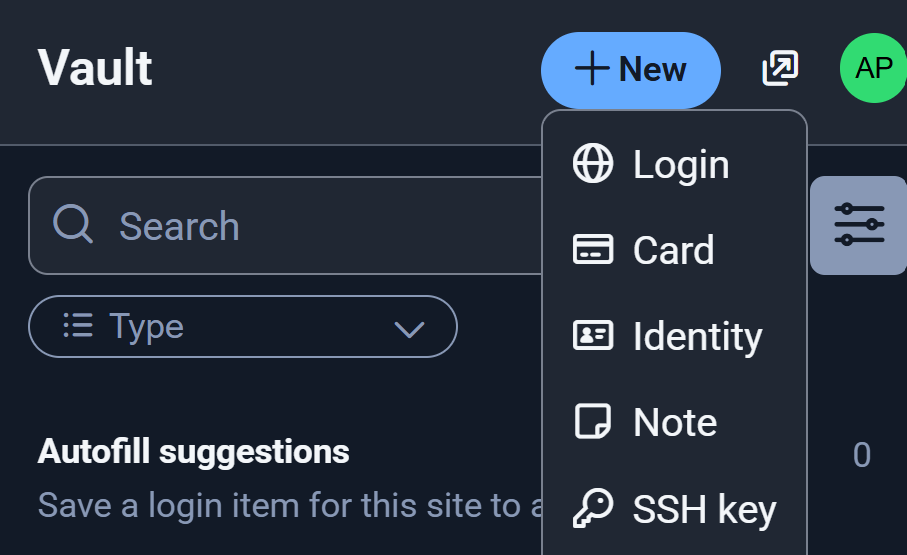
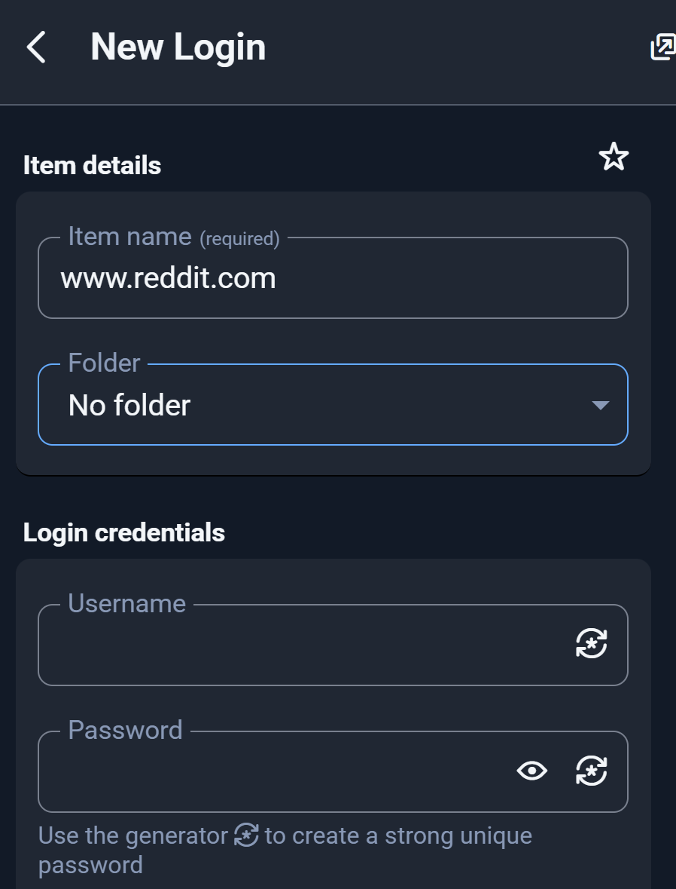

## Chrome
All of the Autonomy Park bookmarks and accounts are saved in our Google Chrome profile. Log in using the Autonomy Park email and password (the lab managers on [Contacts](../contacts.md) can give them to you). Use Chrome on all Autonomy Park computers to keep things consistent. Most things you want for the Autonomy Park are **bookmarked**!

## Bitwarden
Do not use the default Autonomy Park password for any user account. Generate a strong password and save it to [Bitwarden](https://bitwarden.com/). This is installed as an extension in our Chrome profile. To save a new login, do the following:

Navigate to the site which you need a new login for. In this example, we'll use `reddit.com`. Open the Bitwarden extension. Click the `+New` button and then the `Login` button.

{ align="center" width="10%" }

{ align="center" width="50%" }

Fill in the `username` field and click the `generator` button in the `password` field to create a strong unique password.

{ align="center" width="50%" }

Copy the password to your clipboard. Click `Use this password`. Then, click `Save`.
