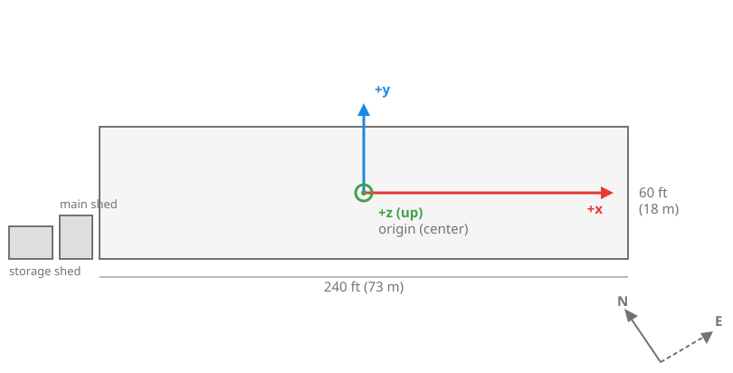

The SCC Lab runs two spaces. The [Autonomy Park](#autonomy-park) is the outdoor space, a university resource. The [Indoor Lab](#indoor-lab) in MAE-A 313 is the indoor motion-capture lab.

## Autonomy Park

{ width="70%" }

*The Autonomy Park from the air.*

The Autonomy Park is 240 ft (73 m) long, 60 ft (18 m) wide, and 20 ft (7 m) tall.

The Autonomy Park is located at the UF Energy Park, which Apple and Google Maps call the UF Solar Park. It's a fenced, gated facility.

[Google Maps](https://maps.app.goo.gl/MvcM2w51dQvM2ucF7){ .md-button }
[Apple Maps](https://maps.apple/p/SC3wj3MogVh~9x){ .md-button }

{ width="70%" }

*The Autonomy Park from above. The netted area is in the middle.*

### Autonomy Park Frame

The Autonomy Park frame is the frame used in the [aero_common](https://github.com/UFL-Autonomy-Park/aero_common) and other repositories.

* **Origin:** the center of the Autonomy Park, at 29.628147° N, 82.360333° W. This coordinate was chosen by Max Gardenswartz on Google Earth very carefully and works well in experiments. Use it everywhere unless you really know what you're doing and find it needs to be (minorly) adjusted (e.g., testing CBFs with quadcopters).
* **x axis:** along the long side of the Park (240 ft, 73 m). It is rotated 33.83072° southward from a true ENU frame (east, north, up).
* **y axis:** along the short side of the Park (60 ft, 18 m), pointing northeast-ish.
* **z axis:** up.
* **Sheds:** both sheds sit at the -x end of the Park. The main shed is the one closer to the net; the storage shed is farther out.

{ width="80%" }

To get access to either space, see [Lab Access](access/lab-access.md).

## Indoor Lab

!!! note "Safety Nets Are Planned"
    Safety nets are planned as a future safety feature of the Indoor Lab. As of 2026-10-21 they are not installed. When and where they will go: *Unknown*{ .unknown }.

{ width="70%" }

*The Indoor Lab (MAE-A 313). The black units on the ceiling are the motion-capture cameras.*

The Indoor Lab (MAE-A 313) has about 18 ft by 9 ft by 44 ft (5.5 m, 2.75 m, 13.5 m) of space for autonomous experiments.

The origin of the mocap system was calibrated so that, the space is divided around it as follows:

| Axis | Positive direction | Space on the positive side | Space on the negative side | Total |
|---|---|---|---|---|
| x | From inside the building out the west window | 9 ft (2.75 m) | 9 ft (2.75 m) | 18 ft (5.5 m) |
| y | Up | 7 ft (2.1 m) | None. The origin is on the floor. | 7 ft (2.1 m) |
| z | North | 20 ft (6 m) | 24 ft (7.5 m) | 44 ft (13.5 m) |

{ width="60%" }

*Plan view, drawn to scale from the table above. West is on the left because north is at the top.*

!!! note "These axes are not ENU"
    The axes do not follow a convention like ENU. They are simply how OptiTrack Motive, the mocap software, sets them up. See [Mocap Calibration](../hardware/mocap-calibration.md) for how the origin and axes are set.

